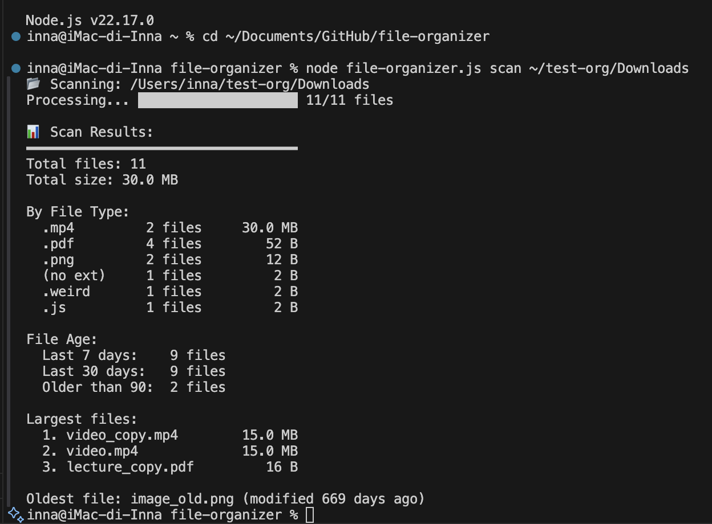
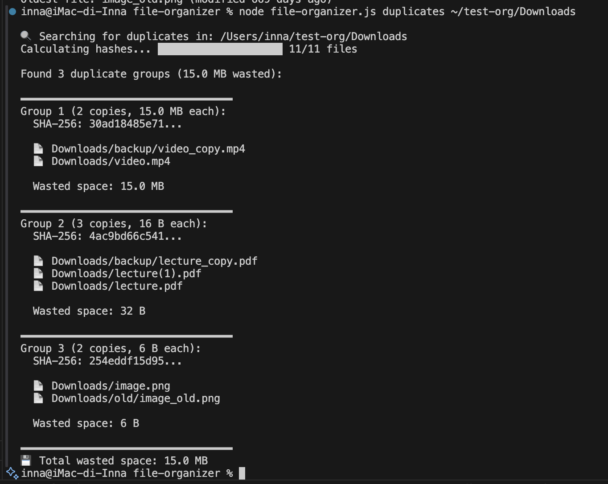
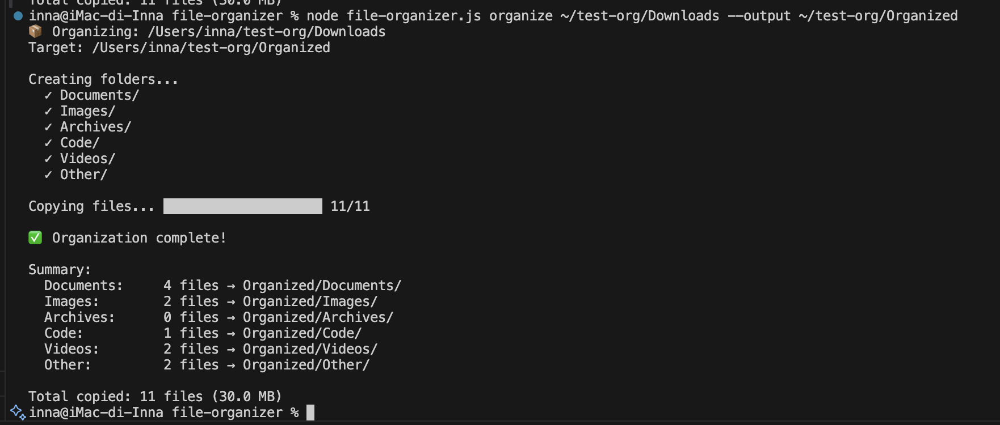
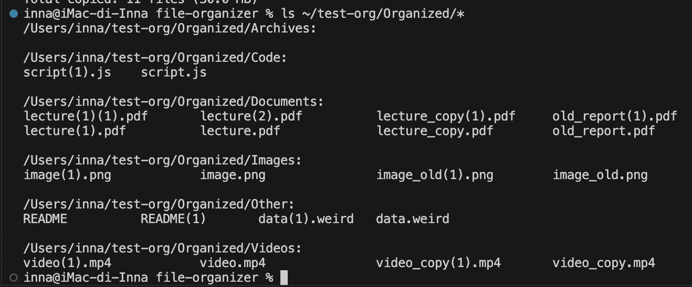
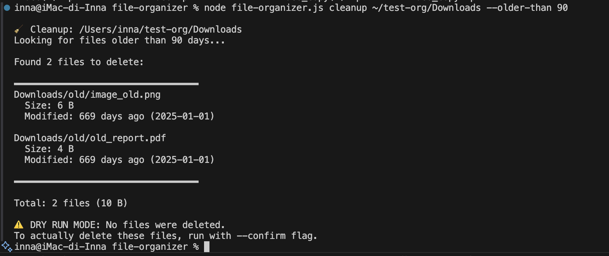
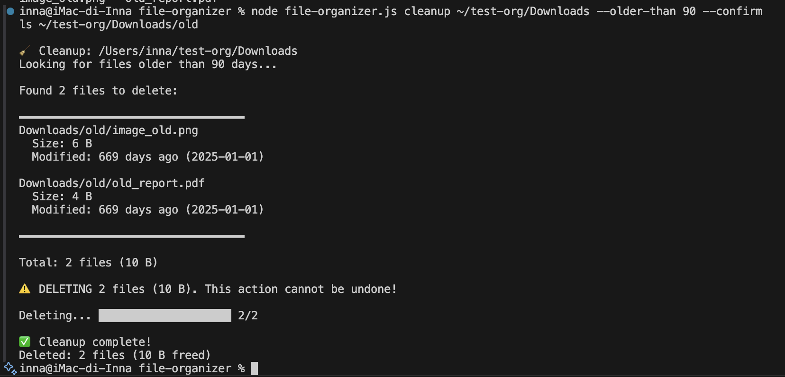
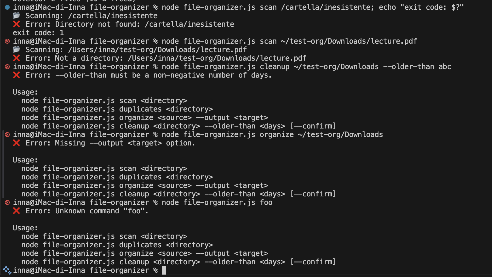
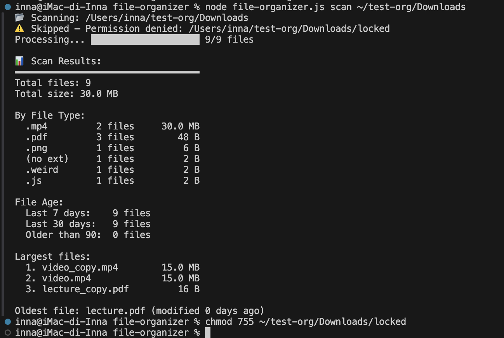
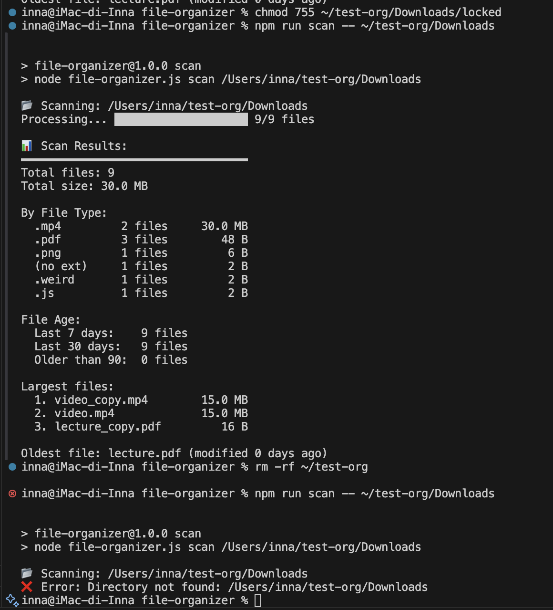

# file-organizer

A Node.js CLI tool for tidying up directories like `Downloads`:
analyze their contents, find duplicates, sort files into categories and remove stale files.

The app has no external dependencies — it uses only built-in Node.js modules
(`fs`, `path`, `crypto`, `events`, `stream`).

## Installation

Requires **Node.js 18+** (tested on Node.js 22).

```bash
git clone https://github.com/InnaIvBoiko/file-organizer.git
cd file-organizer
npm install   # there are no dependencies; this only creates package-lock.json
```

## Quick start

```bash
node file-organizer.js scan ~/Downloads
node file-organizer.js duplicates ~/Downloads
node file-organizer.js organize ~/Downloads --output ~/Organized
node file-organizer.js cleanup ~/Downloads --older-than 90
```

The same via npm scripts (`--` passes the remaining arguments to the script):

```bash
npm run scan -- ~/Downloads
npm run duplicates -- ~/Downloads
npm run organize -- ~/Downloads --output ~/Organized
npm run cleanup -- ~/Downloads --older-than 90 --confirm
```

Help: `node file-organizer.js --help`

## Commands

### `scan <directory>` — analyze a directory

| Argument      | Required | Description              |
| ------------- | -------- | ------------------------ |
| `<directory>` | yes      | Directory to analyze     |

Recursively walks the directory and all its subdirectories, calls `fs.stat()` for every file
and prints a report:

- total number of files and their total size;
- grouping by extension (count and size; more than 10 types are merged into `(other)`);
- age distribution: modified in the last 7 days, in the last 30 days (including the first 7), older than 90 days;
- top 3 largest files;
- the oldest file.

```
$ node file-organizer.js scan ~/Downloads
📂 Scanning: /Users/student/Downloads
Processing... ████████████████████ 247/247

📊 Scan Results:
━━━━━━━━━━━━━━━━━━━━━━━━━━━━━━━━━━
Total files: 247
Total size: 1.20 GB

By File Type:
  .pdf       89 files    456.0 MB
  .zip       23 files    234.0 MB
  ...

File Age:
  Last 7 days:    45 files
  Last 30 days:   89 files
  Older than 90:  56 files

Largest files:
  1. video_lecture.mp4     450.0 MB
  2. archive_backup.zip    156.0 MB
  3. presentation.pptx      89.0 MB

Oldest file: old_report.pdf (modified 365 days ago)
```

### `duplicates <directory>` — find duplicates

| Argument      | Required | Description                         |
| ------------- | -------- | ----------------------------------- |
| `<directory>` | yes      | Directory to search for duplicates  |

Finds files with identical content (even if their names differ) using a **SHA-256** hash.
The hash is computed with `fs.createReadStream()` chunk by chunk, so large files are never
loaded into memory in full.

Optimization: files are first grouped by size — files of different sizes can't be duplicates,
so only files sharing a size are hashed (the progress bar counts only those). Empty (0-byte) files
are ignored. Hashed files are grouped in a `Map<hash, { size, filePaths }>` and only groups with
more than one file are shown.

Wasted space = file size × (number of copies − 1).

```
$ node file-organizer.js duplicates ~/Downloads
🔍 Searching for duplicates in: /Users/student/Downloads
Calculating hashes... ████████████████████ 12/12

Found 2 duplicate groups (6.4 MB wasted):

━━━━━━━━━━━━━━━━━━━━━━━━━━━━━━━━━━
Group 1 (3 copies, 3.2 MB each):
  SHA-256: a3f2e1b8c4d5...

  📄 Downloads/backup/lecture_copy.pdf
  📄 Downloads/lecture(1).pdf
  📄 Downloads/lecture.pdf

  Wasted space: 6.4 MB
...
💾 Total wasted space: 6.4 MB
```

### `organize <source> --output <target>` — sort into categories

| Argument            | Required | Description                                       |
| ------------------- | -------- | ------------------------------------------------- |
| `<source>`          | yes      | Directory with the files to organize              |
| `--output <target>` | yes      | Where to copy the files (created automatically)   |

**Copies** (does not move!) files into category subfolders. The originals stay where they are.

| Category    | Extensions                                   |
| ----------- | -------------------------------------------- |
| `Documents` | .pdf .docx .doc .txt .md .xlsx .pptx         |
| `Images`    | .png .jpg .jpeg .gif .svg .webp .bmp         |
| `Archives`  | .zip .rar .tar .gz .7z                       |
| `Code`      | .js .py .java .cpp .html .css .json          |
| `Videos`    | .mp4 .avi .mkv .mov .webm                    |
| `Other`     | everything else, including files without an extension |

Details:

- files **under 10 MB** are copied with `fs.copyFile()`, files **of 10 MB or more** with streams
  (`pipeline(createReadStream, createWriteStream)`) so the whole file is never held in memory;
- **name conflicts**: existing files are never overwritten — a numeric suffix is added instead:
  `file.pdf → file(1).pdf → file(2).pdf ...`;
- if the output directory is inside the source directory, its contents are not copied again;
- `<source>` and `--output` cannot be the same directory.

```
$ node file-organizer.js organize ~/Downloads --output ~/Organized
📦 Organizing: /Users/student/Downloads
Target: /Users/student/Organized

Creating folders...
  ✓ Documents/
  ✓ Images/
  ✓ Archives/
  ✓ Code/
  ✓ Videos/
  ✓ Other/
Copying files... ████████████████████ 247/247

✅ Organization complete!

Summary:
  Documents:   134 files → Organized/Documents/
  Images:       67 files → Organized/Images/
  ...

Total copied: 247 files (1.20 GB)
```

### `cleanup <directory> --older-than <days> [--confirm]` — remove old files

| Argument              | Required | Description                                                         |
| --------------------- | -------- | ------------------------------------------------------------------- |
| `<directory>`         | yes      | Directory to clean up (recursively)                                 |
| `--older-than <days>` | yes      | Age in days (based on modification time `mtime`), non-negative number |
| `--confirm`           | no       | Without it — **dry run**: the list is shown, nothing is deleted     |

File age: `(Date.now() - stats.mtime.getTime()) / (1000 * 60 * 60 * 24)`.
The list shows the first 10 files (oldest first); the rest are summarized.

```bash
# 1. Preview what would be deleted (safe)
node file-organizer.js cleanup ~/Downloads --older-than 90

# 2. Actually delete
node file-organizer.js cleanup ~/Downloads --older-than 90 --confirm
```

```
🧹 Cleanup: /Users/student/Downloads
Looking for files older than 90 days...

Found 45 files to delete:

━━━━━━━━━━━━━━━━━━━━━━━━━━━━━━━━━━
Downloads/old_report.pdf
  Size: 2.3 MB
  Modified: 120 days ago (2026-07-04)
...
... (35 more files)
━━━━━━━━━━━━━━━━━━━━━━━━━━━━━━━━━━

Total: 45 files (156.0 MB)

⚠️  DRY RUN MODE: No files were deleted.
To actually delete these files, run with --confirm flag.
```

## Error handling

All file system operations are wrapped in `try...catch`. Known error codes get a clear message:

| Code              | Message                                      |
| ----------------- | -------------------------------------------- |
| `ENOENT`          | Directory not found / Not found              |
| `EACCES`, `EPERM` | Permission denied                            |
| `ENOTDIR`         | Not a directory (a file path was given)      |
| `EEXIST`          | Already exists                               |
| `ENOSPC`          | No space left on device                      |
| `EMFILE`, `EBUSY` | Too many open files / Resource busy          |

- A problem with the directory itself or invalid arguments → `❌ Error: ...` message and exit code **1**.
  This includes unknown options (e.g. a typo like `--confrim`) and unexpected extra arguments,
  so a mistyped flag never silently changes what a command does.
- A problem with a single file or subdirectory (e.g. no permission) → the file is skipped with a warning
  and the command keeps going.

## Screenshots

Real runs on a test directory with duplicates, a 15 MB video (copied via streams) and files
dated 2025-01-01 to simulate old files.

### `scan`



### `duplicates`

3 duplicate groups are found. (This screenshot was taken before the size pre-filter was added,
so all 11 files were hashed; now only files with matching sizes are.)



### `organize`



After running `organize` twice, nothing is overwritten — name conflicts get a numeric suffix
(`lecture(1).pdf`, `lecture(2).pdf`, `video(1).mp4` …):



### `cleanup` — dry run



### `cleanup --confirm`



### Error handling

Missing directory (exit code 1), file instead of directory, invalid `--older-than`,
missing `--output`, unknown command:



Unreadable subfolder (`EACCES`) — skipped with a warning, the scan continues:



### npm scripts



## Project structure

```
file-organizer/
├── package.json        # "type": "module", npm scripts
├── .gitignore
├── README.md
├── file-organizer.js   # entry point: process.argv parsing, console output, progress bar, error handling
├── images/             # screenshots used in this README
└── lib/
    ├── scanner.js      # Scanner, getAllFiles() — recursive walk shared by all commands,
    │                   # calculateStatistics() — pure function that builds the scan report
    ├── duplicates.js   # DuplicateFinder + stream-based calculateHash()
    ├── organizer.js    # Organizer, category map, getUniquePath() for name conflicts
    └── cleanup.js      # Cleanup — finding and deleting old files
```

## Architecture: EventEmitter

Each command is a separate class extending `EventEmitter`. The classes contain only business logic
and never print to the console; `file-organizer.js` subscribes to their events and draws the progress
bar and reports. This means the same classes could be reused in a GUI or a web server, for example.

| Class             | Events                                                                                      |
| ----------------- | ------------------------------------------------------------------------------------------- |
| `Scanner`         | `scan-start`, `files-listed`, `file-found`, `file-error`, `scan-complete`                  |
| `DuplicateFinder` | `search-start`, `hashing-start`, `file-processed`, `file-error`, `duplicates-found`         |
| `Organizer`       | `organize-start`, `folder-created`, `copy-start`, `copy-complete`, `copy-error`, `organize-complete` |
| `Cleanup`         | `cleanup-start`, `file-found`, `search-complete`, `delete-start`, `file-deleted`, `file-error`, `cleanup-complete` |

Using a class on its own, outside the CLI:

```js
import { Scanner } from './lib/scanner.js';

const scanner = new Scanner();
scanner.on('file-found', ({ processed, total }) => console.log(`${processed}/${total}`));
scanner.on('scan-complete', (stats) => console.log(stats.totalFiles));
await scanner.scan('./some-folder');
```
